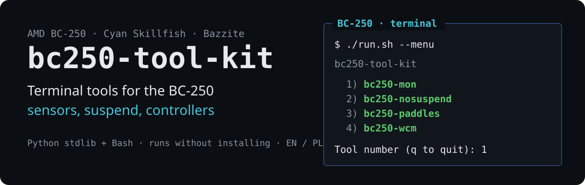
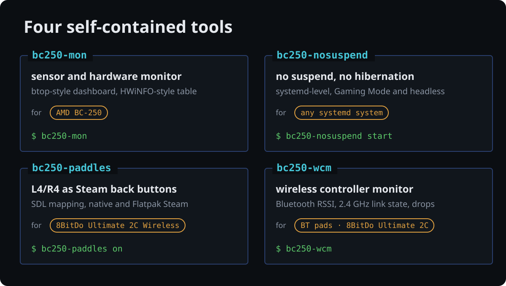

# bc250-tool-kit

**English** · [Polski](README.pl.md)

<p align="center">
  
</p>

Terminal tools for the **AMD BC-250** board (Cyan Skillfish APU, gfx1013) on
**Bazzite** and other Linux distributions: a sensor monitor that knows the
board's quirks, a reliable suspend block, and two tools for wireless game
controllers. Every tool is **self-contained** — its own directory, README,
documentation, manual page, tests and installer — so a single directory from
`tools/` works without the rest of the kit.

<p align="center">
  
</p>

| Tool | What it does | Hardware | Docs |
|---|---|---|---|
| [`bc250-mon`](tools/bc250-mon/) | terminal sensor and hardware monitor — a `btop`-like dashboard, a HWiNFO-like sensor table, diagnostics for BC-250 pitfalls | AMD BC-250 | [README](tools/bc250-mon/README.md) · [man](tools/bc250-mon/man/en/bc250-mon.1) · [docs](tools/bc250-mon/docs/) |
| [`bc250-nosuspend`](tools/bc250-nosuspend/) | persistent block on suspend and hibernation at the systemd level — works in Gaming Mode and headless too | any systemd system | [README](tools/bc250-nosuspend/README.md) · [man](tools/bc250-nosuspend/man/en/bc250-nosuspend.1) · [docs](tools/bc250-nosuspend/docs/) |
| [`bc250-paddles`](tools/bc250-paddles/) | L4/R4 as independent Steam Input back buttons over the 2.4 GHz receiver (DInput mode), for native and Flatpak Steam | **8BitDo Ultimate 2C Wireless** | [README](tools/bc250-paddles/README.md) · [man](tools/bc250-paddles/man/en/bc250-paddles.1) · [docs](tools/bc250-paddles/docs/) |
| [`bc250-wcm`](tools/bc250-wcm/) | Wireless Controller Monitor — up to four Bluetooth pads and USB 2.4 GHz receivers: live-link RSSI where it exists, receiver link state, input activity, drops, adapter resets, passive HID research | Bluetooth pads · **8BitDo Ultimate 2C Wireless** receiver | [README](tools/bc250-wcm/README.md) · [man](tools/bc250-wcm/man/en/bc250-wcm.1) · [docs](tools/bc250-wcm/docs/) |


*bc250-mon on the reference BC-250 under load.*

## Quick start

Nothing needs to be installed — the tools run straight from the repository:

```bash
git clone https://github.com/zvgelo/bc250-tool-kit.git
cd bc250-tool-kit

./run.sh                        # list the tools
./run.sh --menu                 # pick one from a numbered menu
./run.sh bc250-mon --demo       # preview on a simulated BC-250
./run.sh bc250-mon              # the real thing
./run.sh bc250-nosuspend status # state of the suspend block
./run.sh bc250-paddles status   # L4/R4 mapping for Steam, pads and their mode
./run.sh bc250-wcm --demo       # controller monitor on simulated pads and a receiver
./run.sh bc250-mon --help       # a tool's options
```

> **Copied the kit without Unix permissions?** A FAT/exFAT stick or a network
> share loses the executable bit. `run.sh` copes on its own, and
> `bash ./install.sh` (below) restores the bits. `git clone` and `rsync -a`
> keep them.

## Installation

Everything at once:

```bash
./install.sh               # all tools for this user; then asks about the optional system parts
./install.sh --system      # the same, system parts without asking (one sudo prompt)
./install.sh --user-only   # never touch the system
```

The user part needs no root and starts nothing — `bc250-nosuspend`, for one,
blocks nothing until you run `bc250-nosuspend start`. It puts symlinks in
`~/.local/bin` and manual pages in `~/.local/share/man`, which survives image
updates on atomic distributions (Bazzite, Silverblue, Bluefin).

The optional system parts are the `bc250-wcm` RSSI helper with its sudoers rule
(no more password prompt) and the udev rule for the 8BitDo receiver's hidraw.
The script also restores executable bits lost by copying the kit, and offers to
remove directories of tools that were renamed since (`tools/bc250-btmon`).

Each tool can also be installed alone: `./tools/<tool>/install.sh`.

## Requirements

- Python 3.9 or newer for `bc250-mon` and `bc250-wcm` — **standard library
  only**, no `pip`, which matters on atomic images. `bc250-nosuspend` and
  `bc250-paddles` need only Bash and systemd.
- A kernel with the `amdgpu` and `k10temp` modules.
- Board sensors need a SuperIO module: `sudo modprobe nct6687 force=true`
  (read + PWM) or `sudo modprobe nct6683 force=true` (read-only).
- `bc250-wcm` needs BlueZ for Bluetooth pads; the RSSI of a live link needs a
  one-time `sudo` per start, or its helper installed once
  (`./install.sh --system`). USB receivers need no privileges.

## What the tools change

- `bc250-mon` **writes nothing** — it reads `sysfs`, `hwmon` and `procfs`, so it
  does not interfere with the GPU governor, CoolerControl or CU/unlock scripts.
- `bc250-wcm` reads BlueZ, sysfs, evdev and the kernel log. The only change it
  can make is starting or stopping Bluetooth discovery, and only on a key press.
  It never writes to a USB receiver.
- `bc250-nosuspend` masks the systemd sleep targets and adds a logind drop-in —
  only on `start`, undone by `stop` or `default`.
- `bc250-paddles` sets one environment variable for Steam (user `environment.d`
  and, for Flatpak, a user override) — only on `on`, undone by `off`.

## Target hardware and test environment

The tools are built for one specific, modified machine — worth keeping in mind
when reading the thresholds and heuristics:

| Item | Configuration |
|---|---|
| Board / APU | AMD BC-250, `cyan_skillfish.gfx1013` |
| System | Bazzite (`ghcr.io/ublue-os/bazzite-deck:stable`), Fedora 44 / rpm-ostree |
| CPU | **8C / 16T** after the unlock (SMU mask `SMN 0x0115A870` = `0xFF`, stock `0x77`) |
| GPU | **38 / 40 CU** — `SE0.SH0=0x1e`, `SE0.SH1=0x1f`, `SE1.SH0=0x1f`, `SE1.SH1=0x1f` |
| GPU governor | `cyan-skillfish-governor-smu` v0.4.12, `set-method = "smu"`, range 1000–1850 MHz |
| Undervolt | about −10 mV against the safe-point table |
| Throttling | 85 °C, recovery 75 °C |
| SuperIO / cooling | NCT6686, CoolerControl 5.x, main fan reported as `Pump Fan` |
| Controllers | 8BitDo Ultimate 2C Wireless (Bluetooth and 2.4 GHz receiver) |

Values observed on that machine: gaming (The Witcher, Ultra) GPU 64–71 °C,
CPU Tctl 68–71 °C, PPT 60–100 W, `Pump Fan` 2300–2500 RPM. A full synthetic
CPU+GPU stress test: CPU ~100 °C, GPU edge ~80 °C, PPT 140–150 W, ~2600 RPM.

What follows from this for the monitor:

- **The unlocked CPU** makes `pp_dpm_sclk` report a nonsensical active GPU
  level — the Diagnostics entry triggers on this configuration and the GPU clock
  comes from `gpu_metrics`.
- **The smu governor** substitutes `gpu_metrics`, so the GPU load reading works
  and no "activity field not populated" message appears.
- **The 90 °C CPU threshold** will be crossed under synthetic stress (~100 °C) —
  that warning is intended, not a false alarm.

## Language

The interface and documentation come in English and Polish.

- **Tools:** the `--lang pl|en` option, then the `BC250_LANG` variable, then the
  system locale, falling back to English.
- **Manual pages:** `man bc250-mon` is English, `LANG=pl_PL.UTF-8 man bc250-mon`
  is Polish.
- **Documentation:** files without a suffix are English, files with `.pl.md` are
  Polish; each one links to its counterpart.

## Repository layout

```
run.sh                    run tools without installing
install.sh                install every tool at once
assets/readme/            images of this README (generated by source/make_img.py)
tools/
  bc250-mon/              sensor and hardware monitor
  bc250-nosuspend/        system suspend block
  bc250-paddles/          L4/R4 of the 8BitDo Ultimate 2C as Steam back buttons
  bc250-wcm/              Wireless Controller Monitor (Bluetooth + USB 2.4 GHz)

  every tool has the same shape:
    bin/<name>            launcher
    docs/                 documentation (English + .pl.md)
    man/{en,pl}/          manual pages
    tests/                tests
    install.sh            installation under ~/.local
    README.md             English
    README.pl.md          Polish
LICENSE
```

## Tests

Tests need no BC-250, pads or root — hardware, BlueZ and systemd are simulated.
Run them from a tool's directory:

```bash
cd tools/bc250-mon       && python3 -m unittest discover -s tests -v
cd tools/bc250-nosuspend && ./tests/test-bc250-nosuspend.sh
cd tools/bc250-paddles   && ./tests/test-bc250-paddles.sh
cd tools/bc250-wcm       && python3 -m unittest discover -s tests -v
```

Bug reports and pull requests are welcome in
[the issue tracker](https://github.com/zvgelo/bc250-tool-kit/issues); each
tool's README says what output to attach.

## Source documentation

The kit builds on the BC-250 community documentation:
**[elektricM/amd-bc250-docs](https://github.com/elektricM/amd-bc250-docs)**.
This repository does not contain a copy of it; to keep it at hand locally:

```bash
git clone https://github.com/elektricM/amd-bc250-docs.git docs-ref   # docs-ref/ is in .gitignore
```

## Licence

MIT — see [LICENSE](LICENSE).
