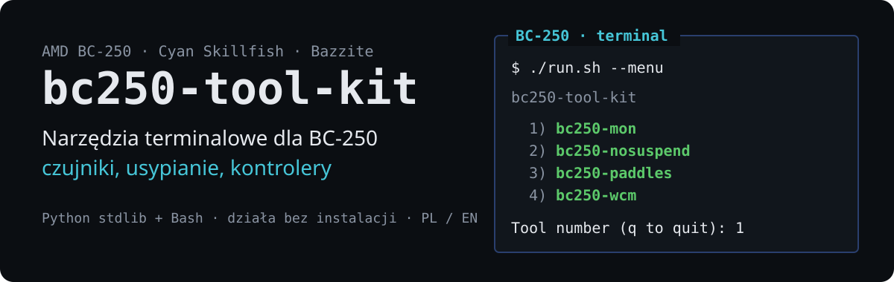
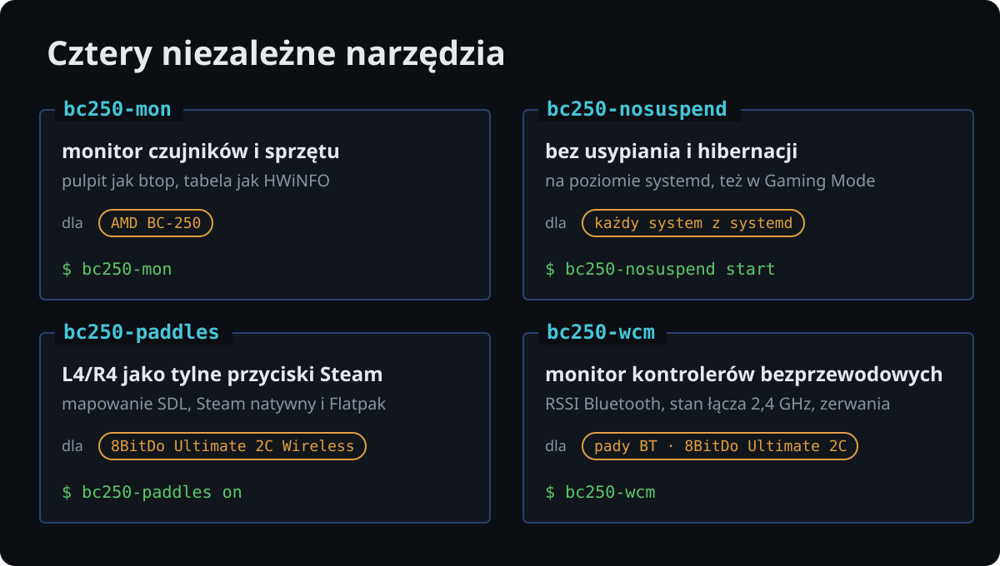
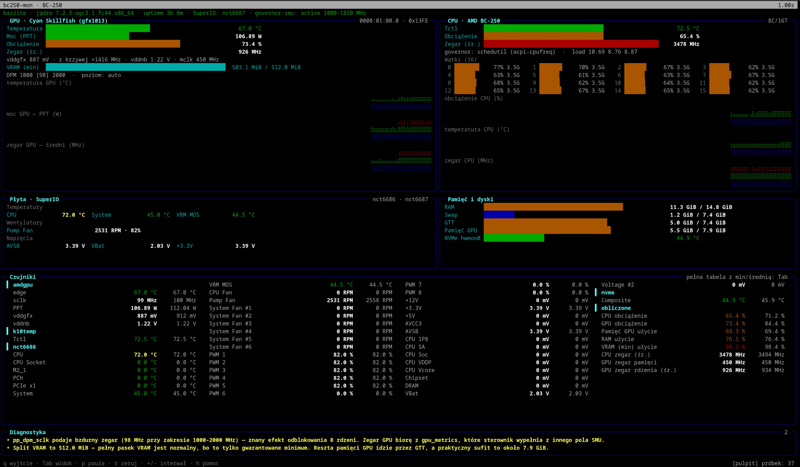

# bc250-tool-kit

[English](README.md) · **Polski**

<p align="center">
  
</p>

Narzędzia terminalowe dla płyty **AMD BC-250** (APU Cyan Skillfish, gfx1013) pod
**Bazzite** i innymi dystrybucjami Linuksa: monitor czujników znający pułapki tej
płyty, niezawodna blokada usypiania i dwa narzędzia do bezprzewodowych
kontrolerów. Każde narzędzie jest **samodzielne** — ma własny katalog, README,
dokumentację, stronę podręcznika, testy i instalator — więc pojedynczy katalog
z `tools/` działa bez reszty zestawu.

<p align="center">
  
</p>

| Narzędzie | Co robi | Sprzęt | Dokumentacja |
|---|---|---|---|
| [`bc250-mon`](tools/bc250-mon/) | terminalowy monitor czujników i sprzętu — pulpit jak `btop`, tabela czujników jak HWiNFO, diagnostyka pułapek BC-250 | AMD BC-250 | [README](tools/bc250-mon/README.pl.md) · [man](tools/bc250-mon/man/pl/bc250-mon.1) · [docs](tools/bc250-mon/docs/) |
| [`bc250-nosuspend`](tools/bc250-nosuspend/) | trwała blokada usypiania i hibernacji na poziomie systemd — działa też w Gaming Mode i bez ekranu | każdy system z systemd | [README](tools/bc250-nosuspend/README.pl.md) · [man](tools/bc250-nosuspend/man/pl/bc250-nosuspend.1) · [docs](tools/bc250-nosuspend/docs/) |
| [`bc250-paddles`](tools/bc250-paddles/) | L4/R4 jako niezależne tylne przyciski Steam Input przez odbiornik 2,4 GHz (tryb DInput), dla Steama natywnego i z Flatpaka | **8BitDo Ultimate 2C Wireless** | [README](tools/bc250-paddles/README.pl.md) · [man](tools/bc250-paddles/man/pl/bc250-paddles.1) · [docs](tools/bc250-paddles/docs/) |
| [`bc250-wcm`](tools/bc250-wcm/) | Wireless Controller Monitor — do czterech padów Bluetooth i odbiorników USB 2,4 GHz: RSSI łącza tam, gdzie istnieje, stan łącza odbiornika, aktywność wejścia, rozłączenia, resety adaptera, pasywne badanie HID | pady Bluetooth · odbiornik **8BitDo Ultimate 2C Wireless** | [README](tools/bc250-wcm/README.pl.md) · [man](tools/bc250-wcm/man/pl/bc250-wcm.1) · [docs](tools/bc250-wcm/docs/) |



*bc250-mon na wzorcowej BC-250 pod obciążeniem.*

## Szybki start

Nic nie trzeba instalować — narzędzia działają prosto z repozytorium:

```bash
git clone https://github.com/zvgelo/bc250-tool-kit.git
cd bc250-tool-kit

./run.sh                        # lista narzędzi
./run.sh --menu                 # wybór z ponumerowanego menu
./run.sh bc250-mon --demo       # podgląd na symulowanej BC-250
./run.sh bc250-mon              # na prawdziwym sprzęcie
./run.sh bc250-nosuspend status # stan blokady usypiania
./run.sh bc250-paddles status   # mapowanie L4/R4 dla Steama, pady i ich tryb
./run.sh bc250-wcm --demo       # monitor kontrolerów na symulowanych padach i odbiorniku
./run.sh bc250-mon --help       # opcje narzędzia
```

> **Zestaw skopiowany bez uprawnień uniksowych?** Pendrive FAT/exFAT albo udział
> sieciowy gubi bit wykonywalności. `run.sh` radzi sobie z tym sam, a
> `bash ./install.sh` (niżej) przywraca bity. `git clone` i `rsync -a` je
> zachowują.

## Instalacja

Wszystko naraz:

```bash
./install.sh               # wszystkie narzędzia dla tego użytkownika; potem pyta o opcjonalne części systemowe
./install.sh --system      # to samo, części systemowe bez pytania (jedno pytanie sudo o hasło)
./install.sh --user-only   # nigdy nie dotykaj systemu
```

Część użytkownika nie wymaga roota i niczego nie uruchamia — `bc250-nosuspend`
na przykład niczego nie blokuje, dopóki nie wykonasz `bc250-nosuspend start`.
Zakłada dowiązania w `~/.local/bin` i strony podręcznika w `~/.local/share/man`,
co przeżywa aktualizacje obrazu na dystrybucjach atomowych (Bazzite,
Silverblue, Bluefin).

Opcjonalne części systemowe to helper RSSI `bc250-wcm` z regułą sudoers (koniec
z pytaniem o hasło) oraz reguła udev dla hidraw odbiornika 8BitDo. Skrypt
przywraca też bity wykonywalności zgubione przy kopiowaniu zestawu i proponuje
usunięcie katalogów narzędzi, które zmieniły nazwę (`tools/bc250-btmon`).

Każde narzędzie można też zainstalować osobno: `./tools/<narzędzie>/install.sh`.

## Wymagania

- Python 3.9 lub nowszy dla `bc250-mon` i `bc250-wcm` — **wyłącznie biblioteka
  standardowa**, żadnego `pip`, co ma znaczenie na obrazach atomowych.
  `bc250-nosuspend` i `bc250-paddles` potrzebują tylko Basha i systemd.
- Jądro z modułami `amdgpu` i `k10temp`.
- Czujniki płyty wymagają modułu SuperIO: `sudo modprobe nct6687 force=true`
  (odczyt + PWM) albo `sudo modprobe nct6683 force=true` (tylko odczyt).
- `bc250-wcm` wymaga BlueZ dla padów Bluetooth; RSSI aktywnego łącza wymaga
  jednorazowego `sudo` na uruchomienie albo raz zainstalowanego helpera
  (`./install.sh --system`). Odbiorniki USB nie wymagają uprawnień.

## Co narzędzia zmieniają

- `bc250-mon` **niczego nie zapisuje** — czyta `sysfs`, `hwmon` i `procfs`, więc
  nie koliduje z governorem GPU, CoolerControl ani skryptami CU/unlock.
- `bc250-wcm` czyta BlueZ, sysfs, evdev i dziennik jądra. Jedyna zmiana, jaką
  może zrobić, to włączenie lub wyłączenie wyszukiwania Bluetooth — i tylko po
  naciśnięciu klawisza. Nigdy nie zapisuje niczego do odbiornika USB.
- `bc250-nosuspend` maskuje cele uśpienia systemd i dodaje drop-in logind —
  tylko przy `start`, cofane przez `stop` albo `default`.
- `bc250-paddles` ustawia jedną zmienną środowiskową dla Steama (użytkownika
  `environment.d`, a dla Flatpaka nadpisanie użytkownika) — tylko przy `on`,
  cofane przez `off`.

## Sprzęt docelowy i środowisko testowe

Narzędzia powstają pod konkretną, zmodyfikowaną maszynę — warto o tym pamiętać,
czytając progi i heurystyki:

| Element | Konfiguracja |
|---|---|
| Płyta / APU | AMD BC-250, `cyan_skillfish.gfx1013` |
| System | Bazzite (`ghcr.io/ublue-os/bazzite-deck:stable`), Fedora 44 / rpm-ostree |
| CPU | **8C / 16T** po odblokowaniu (maska SMU `SMN 0x0115A870` = `0xFF`, stock `0x77`) |
| GPU | **38 / 40 CU** — `SE0.SH0=0x1e`, `SE0.SH1=0x1f`, `SE1.SH0=0x1f`, `SE1.SH1=0x1f` |
| Governor GPU | `cyan-skillfish-governor-smu` v0.4.12, `set-method = "smu"`, zakres 1000–1850 MHz |
| Undervolt | ok. −10 mV względem tabeli safe-points |
| Throttling | 85 °C, recovery 75 °C |
| SuperIO / chłodzenie | NCT6686, CoolerControl 5.x, główny wentylator jako `Pump Fan` |
| Kontrolery | 8BitDo Ultimate 2C Wireless (Bluetooth i odbiornik 2,4 GHz) |

Zaobserwowane wartości na tej maszynie: gaming (Wiedźmin, Ultra) GPU 64–71 °C,
CPU Tctl 68–71 °C, PPT 60–100 W, `Pump Fan` 2300–2500 RPM. Pełny syntetyczny
stress CPU+GPU: CPU ~100 °C, GPU edge ~80 °C, PPT 140–150 W, ~2600 RPM.

Co z tego wynika dla monitora:

- **Odblokowany CPU** sprawia, że `pp_dpm_sclk` pokazuje bzdurny aktywny poziom
  GPU — wpis w Diagnostyce włączy się na tej konfiguracji, a zegar GPU pochodzi
  z `gpu_metrics`.
- **Governor smu** podmienia `gpu_metrics`, więc odczyt obciążenia GPU działa
  i nie pojawi się komunikat o niewypełnionym polu aktywności.
- **Próg CPU 90 °C** będzie przekraczany w syntetycznym stresie (~100 °C) —
  to zamierzone ostrzeżenie, nie fałszywy alarm.

## Język

Interfejs i dokumentacja są po angielsku i po polsku.

- **Narzędzia:** opcja `--lang pl|en`, następnie zmienna `BC250_LANG`, na końcu
  locale systemu; nierozpoznane ustawienie oznacza angielski.
- **Strony podręcznika:** `man bc250-mon` po angielsku,
  `LANG=pl_PL.UTF-8 man bc250-mon` po polsku.
- **Dokumentacja:** pliki bez przyrostka są po angielsku, z `.pl.md` po polsku;
  każdy odsyła do swojego odpowiednika.

## Struktura repozytorium

```
run.sh                    uruchamianie narzędzi bez instalacji
install.sh                instalacja wszystkich narzędzi naraz
assets/readme/            grafiki tego README (generuje je source/make_img.py)
tools/
  bc250-mon/              monitor czujników i sprzętu
  bc250-nosuspend/        blokada usypiania systemu
  bc250-paddles/          L4/R4 pada 8BitDo Ultimate 2C jako tylne przyciski w Steam
  bc250-wcm/              Wireless Controller Monitor (Bluetooth + USB 2,4 GHz)

  każde narzędzie ma ten sam układ:
    bin/<nazwa>           launcher
    docs/                 dokumentacja (angielska + .pl.md)
    man/{en,pl}/          strony podręcznika
    tests/                testy
    install.sh            instalacja w ~/.local
    README.md             po angielsku
    README.pl.md          po polsku
LICENSE
```

## Testy

Testy nie wymagają BC-250, padów ani roota — sprzęt, BlueZ i systemd są
symulowane. Uruchamia się je z katalogu narzędzia:

```bash
cd tools/bc250-mon       && python3 -m unittest discover -s tests -v
cd tools/bc250-nosuspend && ./tests/test-bc250-nosuspend.sh
cd tools/bc250-paddles   && ./tests/test-bc250-paddles.sh
cd tools/bc250-wcm       && python3 -m unittest discover -s tests -v
```

Zgłoszenia błędów i pull requesty są mile widziane
[w systemie zgłoszeń](https://github.com/zvgelo/bc250-tool-kit/issues); README
każdego narzędzia mówi, jaki wynik warto dołączyć.

## Dokumentacja źródłowa

Zestaw opiera się na społecznościowej dokumentacji BC-250:
**[elektricM/amd-bc250-docs](https://github.com/elektricM/amd-bc250-docs)**.
Repozytorium nie zawiera jej kopii; aby mieć ją lokalnie pod ręką:

```bash
git clone https://github.com/elektricM/amd-bc250-docs.git docs-ref   # docs-ref/ jest w .gitignore
```

## Licencja

MIT — patrz [LICENSE](LICENSE).
