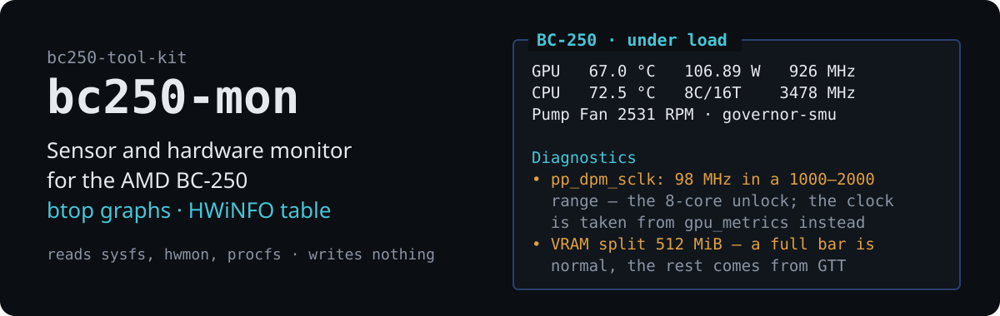
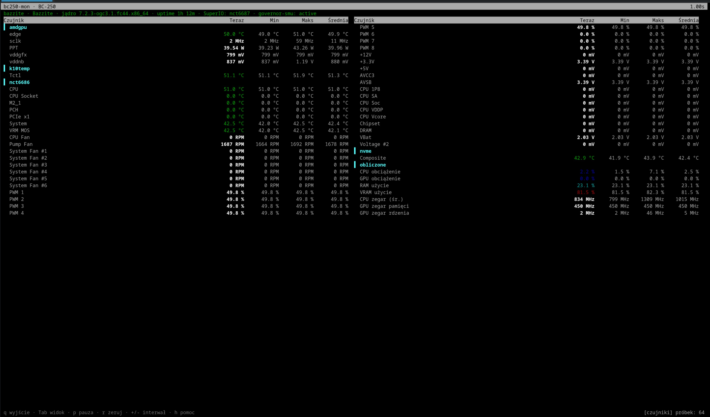

# bc250-mon

<!-- description: terminal sensor and hardware monitor for the BC-250 -->

**English** · [Polski](README.pl.md)

<p align="center">
  
</p>

Terminal sensor and hardware monitor for the **AMD BC-250** (Cyan Skillfish APU,
gfx1013): the layout and graphs of `btop`, the complete sensor table of HWiNFO,
plus knowledge of the quirks specific to this board.

Part of the [bc250-tool-kit](../../README.md) — the tool is self-contained and
works independently of the rest.

## Two views

### Dashboard

Panels for GPU / CPU / board / memory with bars and Braille graphs. Each panel
shows several traces at once (for the GPU: temperature, power and clock), and on
a tall window a condensed sensor table appears below the panels.


### Sensors

Press `Tab`. Every `hwmon` channel with the columns *Now / Min / Max / Average*,
grouped by chip — the equivalent of the HWiNFO sensor window.



## What it knows about the BC-250

This is what separates `bc250-mon` from a plain `btop` or `nvtop` — the tool
recognises the known traps of this board and says plainly what is wrong:

- **`gpu_busy_percent` does not work.** The amdgpu driver leaves the activity
  field in `gpu_metrics` at `0xFFFF` — the source of the famous "655% GPU" in
  MangoHud. The monitor detects that value and reports the cause instead of
  inventing a reading.
- **GPU locked at 1500 MHz.** When the highest DPM level is 1500 MHz and no
  `cyan-skillfish-governor-*` service is running, you are told about it.
- **Clock reporting bug after the 8-core unlock.** It shows up in two ways.
  When the whole `pp_dpm_sclk` table is scaled down (`15Mhz` for 1500 MHz), the
  monitor corrects it by 100 and says so. When the table keeps a sane minimum and
  maximum while only the active level reads nonsense — `0: 1000Mhz  1: 15Mhz *
  2: 2000Mhz`, as seen on the reference board — no scale factor fits, so the
  clock is taken from the averaged field of `gpu_metrics` instead. That is a real
  average which includes clock-gated time, so it sits below the frequency the
  governor sets; when a `cyan-skillfish-governor` config is present, the measured
  `vddgfx` is also mapped back onto the governor's voltage curve
  (`from curve ≈1730 MHz`). The Diagnostics panel explains which case it is.
- **VRAM is a minimum, not a capacity.** `mem_info_vram_total` reports the split
  set with `bc250memcfg`, which is only the memory permanently reserved for the
  GPU; the rest is borrowed through GTT. With the common 512 MB split that bar
  sits near full by design, so the monitor labels it `VRAM (min)`, does not paint
  it as an alarm, and adds a `GPU memory` figure against the real ceiling.
- **Physical cores versus threads.** After unlocking eight cores `nproc` reports
  16 and it is easy to mistake threads for cores. The monitor counts unique
  package:core pairs from `topology/` and states `8C/16T` outright. When the
  thread list does not fit in the window, it says how many it omitted instead of
  truncating silently.
- **nct6683 vs nct6687.** Shows which SuperIO module is loaded and reminds you
  that PWM control requires `nct6687` (`nct6683` is read-only).
- **Temperature thresholds** from the documentation: GPU 85/90 °C, CPU 80/90 °C,
  NVMe 70/80 °C.
- **Fans at 0 RPM** with a working SuperIO module — a hint about the J1 / J4003
  headers and the fan mode in the BIOS. A header that never moves is hidden from
  the dashboard altogether, and a fan that does spin is shown with its duty
  cycle: `2633 RPM · 95%`.

Findings are collected in the **Diagnostics** panel at the bottom of the dashboard.

On hardware other than a BC-250 the monitor falls back to a generic mode: it
shows what it actually finds in `hwmon` and does not pretend to give advice about
a board that is not there.

## Language

The interface and documentation come in Polish and English. The language is
chosen in this order:

1. the `--lang pl|en` option,
2. the `BC250_LANG` environment variable,
3. the system locale (`LC_ALL`, `LC_MESSAGES`, `LANG`),
4. English as the fallback.

```bash
bc250-mon --lang en
BC250_LANG=pl bc250-mon
man bc250-mon                        # English
LANG=pl_PL.UTF-8 man bc250-mon       # Polish
```

## Installation

The tool uses only the Python standard library — no `pip`, which matters on
atomic images (Bazzite, Silverblue, Bluefin).

### Running without installing

```bash
git clone https://github.com/zvgelo/bc250-tool-kit.git
cd bc250-tool-kit

./run.sh bc250-mon --demo          # from the kit root
./tools/bc250-mon/bin/bc250-mon    # or directly
```

### Permanent installation

A symlink in `~/.local/bin` plus manual pages in `~/.local/share/man`, without
root, surviving image updates on atomic distributions:

```bash
./tools/bc250-mon/install.sh   # from the kit's root directory
man bc250-mon
```

Requirements: Python 3.9+ and a kernel with the `amdgpu` and `k10temp` modules.
Board sensors need a loaded SuperIO module:

```bash
sudo modprobe nct6687 force=true    # full access including PWM control
# or
sudo modprobe nct6683 force=true    # read-only
```

## Usage

```bash
bc250-mon                 # interactive monitor
bc250-mon -i 0.5          # refresh every 0.5 s
bc250-mon --once          # one-shot text report (good for bug reports)
bc250-mon --json          # JSON snapshot — for scripts and logging
bc250-mon --demo          # simulated BC-250, preview without the board
bc250-mon --no-diagnostics  # start without the Diagnostics panel (d toggles it)
bc250-mon --lang en       # interface language
```

## Keys

| Key | Action |
|---|---|
| `q`, `Esc` | quit |
| `Tab`, `1`, `2` | switch dashboard ↔ sensors |
| `↑` `↓` `PgUp` `PgDn` `Home` `End` | scroll the sensor table |
| `p`, space | pause refreshing |
| `r` | reset min / max / averages |
| `+` `-` | change the refresh interval |
| `h`, `?` | help |

## Target hardware

The monitor is built for one specific, heavily modified BC-250 (8C/16T, 38/40 CU,
smu governor, undervolt) — the full description of the test machine is in the
[kit README](../../README.md#target-hardware-and-test-environment).

Three consequences of that configuration:

- **The unlocked CPU** makes `pp_dpm_sclk` report a nonsensical active GPU
  level — the Diagnostics entry triggers on that machine and the GPU clock comes
  from `gpu_metrics`.
- **The smu governor** substitutes `gpu_metrics`, so the GPU load reading works.
- **The 90 °C CPU threshold** is exceeded during synthetic stress (~100 °C) —
  that warning is intended, not a false alarm.

`bc250-mon` **writes nothing** — it only reads `sysfs`, `hwmon` and `procfs`, so
it does not interfere with the governor, CoolerControl or the CU/unlock scripts.

## Documentation

- **[`man/en/bc250-mon.1`](man/en/bc250-mon.1)** — manual page (`man bc250-mon`)
- **[`docs/data-sources.md`](docs/data-sources.md)** — the full map of
  readings: which file in `sysfs` gives which value, how `gpu_metrics` is decoded,
  how the clock correction works
- **[`docs/troubleshooting.md`](docs/troubleshooting.md)** — empty panels,
  `n/a` GPU load, 0 RPM, a window that is too small

## Tool layout

```
bin/bc250-mon        launcher
bc250mon/
  sysfs.py           reads sysfs / hwmon / amdgpu / procfs
  collector.py       snapshots, min-max-average statistics, BC-250 diagnostics
  widgets.py         boxes, bars, Braille graphs, colour palette
  tui.py             curses interface (dashboard + sensor table)
  demo.py            simulated BC-250
  cli.py             arguments, text report, JSON
  i18n.py            Polish and English translations
docs/                tool documentation
man/{en,pl}/         manual pages
dev/tuishot.py       TUI layout preview in a pseudo-terminal
tests/               unit tests
install.sh           installation under ~/.local
```

## Development

The interface layout can be inspected without a physical BC-250 and without
resizing a window by hand — `dev/tuishot.py` runs the monitor in a
pseudo-terminal of a given size and prints the resulting frame:

```bash
pip install -r dev/requirements-dev.txt      # the only dependency: pyte
python3 dev/tuishot.py 200 50                # dashboard in demo mode
python3 dev/tuishot.py 120 40 --keys $'\t'   # sensors view
python3 dev/tuishot.py 120 40 --lang en      # English interface
python3 dev/tuishot.py 120 40 --real         # real hardware
```

This is a **development-only** dependency — `bc250-mon` itself needs nothing
outside the standard library.

## Tests

```bash
python3 -m unittest discover -s tests -v
```

## Source documentation

The tool builds on the BC-250 community documentation:
**[elektricM/amd-bc250-docs](https://github.com/elektricM/amd-bc250-docs)**.

This repository does not contain a copy of it. To keep it locally at hand:

```bash
git clone https://github.com/elektricM/amd-bc250-docs.git docs-ref
```

The `docs-ref/` directory (in the repository root) is in `.gitignore`.

## Licence

MIT — see [LICENSE](../../LICENSE) in the repository root.
