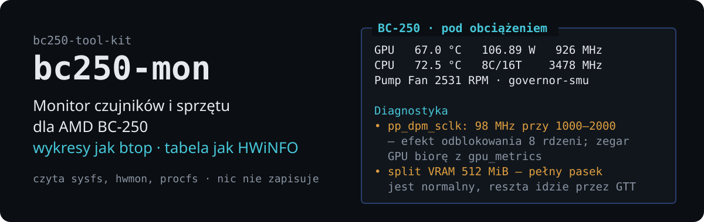

# bc250-mon

<!-- opis: monitor czujników i sprzętu BC-250 w terminalu -->

[English](README.md) · **Polski**

<p align="center">
  
</p>

Terminalowy monitor czujników i sprzętu **AMD BC-250** (APU Cyan Skillfish, gfx1013):
układ i wykresy jak w `btop`, kompletna tabela czujników jak w HWiNFO, ale
z wiedzą o kwiatkach specyficznych dla tej płyty.

Część zestawu [bc250-tool-kit](../../README.pl.md) — narzędzie jest samodzielne
i działa niezależnie od pozostałych.

## Dwa widoki

### Pulpit

Panele GPU / CPU / płyta / pamięć z paskami i wykresami Braille'a. Każdy panel
pokazuje kilka przebiegów naraz (dla GPU temperaturę, moc i zegar), a na wysokim
oknie pod panelami dochodzi skrót tabeli czujników.


### Czujniki

Klawisz `Tab`. Każdy kanał `hwmon` z kolumnami *Teraz / Min / Maks / Średnia*,
pogrupowany po układach — odpowiednik okna czujników w HWiNFO.


## Co wie o BC-250

To jest różnica między `bc250-mon` a zwykłym `btop`/`nvtop` — narzędzie rozpoznaje
znane pułapki tej płyty i mówi wprost, co jest nie tak:

- **`gpu_busy_percent` nie działa.** Sterownik amdgpu zostawia pole aktywności
  w `gpu_metrics` na `0xFFFF` — stąd słynne „655% GPU" w MangoHud. Monitor
  wykrywa tę wartość i zamiast liczby pokazuje przyczynę zamiast zmyślać odczyt.
- **GPU zablokowane na 1500 MHz.** Gdy najwyższy poziom DPM to 1500 MHz i żadna
  usługa `cyan-skillfish-governor-*` nie działa, dostajesz o tym komunikat.
- **Błąd zegara po odblokowaniu 8 rdzeni.** Objawia się na dwa sposoby. Gdy cała
  tabela `pp_dpm_sclk` jest zaniżona (`15Mhz` zamiast 1500 MHz), monitor mnoży
  przez 100 i mówi o tym wprost. Gdy tabela ma sensowne minimum i maksimum, a
  bzdurę pokazuje tylko aktywny poziom — `0: 1000Mhz  1: 15Mhz *  2: 2000Mhz`,
  jak na płycie referencyjnej — żaden mnożnik nie pasuje, więc zegar jest brany
  z uśrednionego pola `gpu_metrics`. To prawdziwa średnia, która obejmuje czas
  z wyłączonym taktowaniem, więc leży poniżej częstotliwości ustawianej przez
  governor; gdy jest konfiguracja `cyan-skillfish-governor`, zmierzone `vddgfx`
  jest dodatkowo odwzorowywane na krzywą napięć governora
  (`z krzywej ≈1730 MHz`). Panel Diagnostyka wyjaśnia, który to przypadek.
- **VRAM to minimum, a nie pojemność.** `mem_info_vram_total` podaje split
  ustawiony przez `bc250memcfg`, czyli tylko pamięć trzymaną na stałe dla GPU;
  reszta jest pożyczana przez GTT. Przy popularnym splicie 512 MB ten pasek stoi
  prawie pełny z założenia, więc monitor podpisuje go `VRAM (min)`, nie maluje na
  alarmowo i dokłada `Pamięć GPU` liczoną wobec prawdziwego sufitu.
- **nct6683 vs nct6687.** Pokazuje, który moduł SuperIO jest załadowany, i
  przypomina, że sterowanie PWM wymaga `nct6687` (`nct6683` jest tylko do odczytu).
- **Rdzenie fizyczne kontra wątki.** Po odblokowaniu ośmiu rdzeni `nproc` pokazuje
  16 i łatwo pomylić wątki z rdzeniami. Monitor liczy unikalne pary pakiet:rdzeń
  z `topology/` i podaje wprost `8C/16T`. Gdy lista wątków nie mieści się w oknie,
  mówi ile ich nie pokazał, zamiast urwać ją po cichu.
- **Progi temperatur** z dokumentacji: GPU 85/90 °C, CPU 80/90 °C, NVMe 70/80 °C.
- **Wentylatory na 0 RPM** przy działającym module SuperIO — podpowiedź o złączach
  J1 / J4003 i trybie wentylatorów w BIOS. Złącze, które nigdy nie drgnęło, znika
  z pulpitu, a kręcący się wentylator pokazywany jest razem z wypełnieniem PWM:
  `2633 RPM · 95%`.

Uwagi zbierane są w panelu **Diagnostyka** na dole pulpitu.

Na sprzęcie innym niż BC-250 monitor przechodzi w tryb ogólny: pokazuje to, co
faktycznie znajdzie w `hwmon`, i nie udaje podpowiedzi o płycie, której nie ma.

## Język

Interfejs i dokumentacja są po polsku i po angielsku. Język wybierany jest
w kolejności:

1. opcja `--lang pl|en`,
2. zmienna `BC250_LANG`,
3. locale systemu (`LC_ALL`, `LC_MESSAGES`, `LANG`),
4. angielski jako ostateczność.

```bash
bc250-mon --lang pl
BC250_LANG=en bc250-mon
LANG=pl_PL.UTF-8 man bc250-mon       # polski
man bc250-mon                        # angielski
```

## Instalacja

Narzędzie korzysta wyłącznie z biblioteki standardowej Pythona — bez `pip`,
co ma znaczenie na obrazach atomowych (Bazzite, Silverblue, Bluefin).

### Uruchomienie bez instalacji

Nic nie trzeba instalować — narzędzie działa prosto z katalogu repozytorium:

```bash
git clone https://github.com/zvgelo/bc250-tool-kit.git
cd bc250-tool-kit

./run.sh bc250-mon --demo          # z katalogu głównego zestawu
./tools/bc250-mon/bin/bc250-mon    # albo bezpośrednio
```

### Instalacja na stałe

Instalacja dla użytkownika — dowiązanie w `~/.local/bin` plus strona podręcznika
w `~/.local/share/man` (bez roota, przeżywa aktualizacje obrazu):

```bash
./tools/bc250-mon/install.sh   # z katalogu głównego zestawu
man bc250-mon
```

Wymagania: Python 3.9+ oraz jądro z modułami `amdgpu` i `k10temp`.
Czujniki płyty wymagają załadowanego modułu SuperIO:

```bash
sudo modprobe nct6687 force=true    # pełny odczyt + sterowanie PWM
# albo
sudo modprobe nct6683 force=true    # tylko odczyt
```

## Użycie

```bash
bc250-mon                 # interaktywny monitor
bc250-mon -i 0.5          # odświeżanie co 0,5 s
bc250-mon --once          # jednorazowy raport tekstowy (dobry do zgłoszeń błędów)
bc250-mon --json          # migawka w JSON — do skryptów i logowania
bc250-mon --demo          # symulowana BC-250, do podglądu bez płyty
bc250-mon --no-diagnostics  # start bez panelu Diagnostyka (d go przełącza)
bc250-mon --lang en       # język interfejsu
```

## Klawisze

| Klawisz | Działanie |
|---|---|
| `q`, `Esc` | wyjście |
| `Tab`, `1`, `2` | przełączanie pulpit ↔ czujniki |
| `↑` `↓` `PgUp` `PgDn` `Home` `End` | przewijanie tabeli czujników |
| `p`, spacja | pauza odświeżania |
| `r` | wyzerowanie min / maks / średnich |
| `+` `-` | zmiana interwału odświeżania |
| `h`, `?` | pomoc |

## Sprzęt docelowy

Monitor powstaje pod konkretną, zmodyfikowaną BC-250 (8C/16T, 38/40 CU,
governor smu, undervolt) — pełny opis maszyny testowej znajdziesz w
[README zestawu](../../README.pl.md#sprzęt-docelowy-i-środowisko-testowe).

Trzy rzeczy wynikające z tej konfiguracji:

- **Odblokowany CPU** sprawia, że `pp_dpm_sclk` pokazuje bzdurny aktywny
  poziom GPU — wpis w Diagnostyce włączy się na tej maszynie, a zegar GPU
  pochodzi z `gpu_metrics`.
- **Governor smu** podmienia `gpu_metrics`, więc odczyt obciążenia GPU działa.
- **Próg CPU 90 °C** bywa przekraczany w syntetycznym stresie (~100 °C) —
  to zamierzone ostrzeżenie, nie fałszywy alarm.

`bc250-mon` **niczego nie zapisuje** — czyta wyłącznie `sysfs`, `hwmon` i `procfs`,
więc nie koliduje z governorem, CoolerControl ani skryptami CU/unlock.

## Dokumentacja

- **[`man/pl/bc250-mon.1`](man/pl/bc250-mon.1)** — strona podręcznika (`LANG=pl_PL.UTF-8 man bc250-mon`)
- **[`docs/data-sources.pl.md`](docs/data-sources.pl.md)** — pełna mapa odczytów: który plik
  w `sysfs` daje którą wartość, jak dekodujemy `gpu_metrics`, jak działa korekta zegara
- **[`docs/troubleshooting.pl.md`](docs/troubleshooting.pl.md)** — puste panele,
  `n/d` przy obciążeniu GPU, 0 RPM, za małe okno

## Struktura narzędzia

```
bin/bc250-mon        launcher
bc250mon/
  sysfs.py           odczyt sysfs / hwmon / amdgpu / procfs
  collector.py       migawki, statystyki min-maks-średnia, diagnostyka BC-250
  widgets.py         ramki, paski, wykresy Braille'a, paleta kolorów
  tui.py             interfejs curses (pulpit + tabela czujników)
  demo.py            symulowana BC-250
  cli.py             argumenty, raport tekstowy, JSON
  i18n.py            tłumaczenia polskie i angielskie
docs/                dokumentacja narzędzia
man/{pl,en}/         strony podręcznika
dev/tuishot.py       podgląd układu TUI w pseudoterminalu
tests/               testy jednostkowe
install.sh           instalacja w ~/.local
```

## Rozwój

Układ interfejsu można obejrzeć bez fizycznej BC-250 i bez ręcznego zmieniania
rozmiaru okna — `dev/tuishot.py` uruchamia monitor w pseudoterminalu zadanej
wielkości i wypisuje gotową klatkę:

```bash
pip install -r dev/requirements-dev.txt      # jedyna zależność: pyte
python3 dev/tuishot.py 200 50                # pulpit w trybie demo
python3 dev/tuishot.py 120 40 --keys $'\t'   # widok czujników
python3 dev/tuishot.py 120 40 --real         # prawdziwy sprzęt
```

To zależność **wyłącznie deweloperska** — samo `bc250-mon` nie wymaga niczego
spoza biblioteki standardowej.

## Testy

```bash
python3 -m unittest discover -s tests -v
```

## Dokumentacja źródłowa

Narzędzie opiera się na społecznościowej dokumentacji BC-250:
**[elektricM/amd-bc250-docs](https://github.com/elektricM/amd-bc250-docs)**.

Repozytorium nie zawiera jej kopii. Aby mieć ją lokalnie pod ręką:

```bash
git clone https://github.com/elektricM/amd-bc250-docs.git docs-ref
```

Katalog `docs-ref/` (w katalogu głównym repozytorium) jest w `.gitignore`.

## Licencja

MIT — patrz [LICENSE](../../LICENSE) w katalogu głównym repozytorium.
