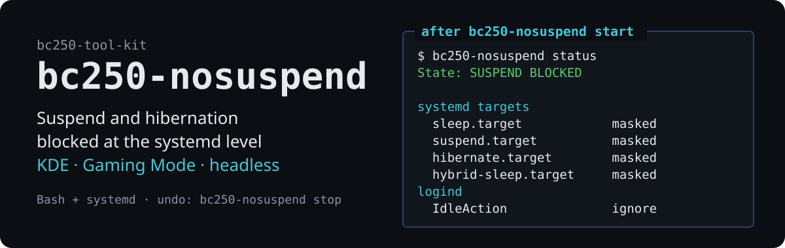

# bc250-nosuspend

<!-- description: persistent block on system suspend and hibernation -->

**English** · [Polski](README.pl.md)

<p align="center">
  
</p>

Blocks suspend and hibernation on the BC-250 at the **systemd** level rather than
in desktop settings — so it works the same in KDE, in Gaming Mode and on a
machine with no display.

Part of the [bc250-tool-kit](../../README.md) — the tool is self-contained and
works independently of the rest.

## Why

A BC-250 is often used as a console, a home server or an inference machine. In
each of those roles, suspending in the middle of a long job — a compile, a game
download, an Ollama session — is simply lost work. KDE power settings can be
overwritten by Bazzite image updates and do not apply in Gaming Mode, so cutting
suspend off inside systemd itself is more reliable.

## Usage

```bash
bc250-nosuspend status     # what is blocked, and by what
bc250-nosuspend start      # block suspend (persistently, across reboots)
bc250-nosuspend stop       # remove the block this tool set
bc250-nosuspend default    # restore system defaults
```

`start` also answers to `on` and `disable`, `stop` to `off` and `enable`,
`default` to `reset`. `status` works without root. `start`, `stop` and `default` need it — the tool
retries through `sudo` on its own.

Before any change it is worth seeing what will happen:

```bash
bc250-nosuspend start --dry-run
```

### A sample `status`

```
bc250-nosuspend 0.1.0

  State: SUSPEND BLOCKED

  systemd targets
    sleep.target                     masked
    suspend.target                   masked
    hibernate.target                 masked
    hybrid-sleep.target              masked
    suspend-then-hibernate.target    masked

  logind
    IdleAction                       ignore — idling will not suspend
    bc250-nosuspend drop-in          present  /etc/systemd/logind.conf.d/10-bc250-nosuspend.conf

  Other
    active inhibitors                6  (systemd-inhibit --list)
```

### `status` exit codes

| Code | Meaning |
|---|---|
| 0 | suspend blocked |
| 1 | suspend possible |
| 2 | partially blocked |

Useful in scripts:

```bash
bc250-nosuspend status >/dev/null || bc250-nosuspend start
```

## What it actually does

`start` does two things:

1. **Masks five systemd targets** — `sleep.target`, `suspend.target`,
   `hibernate.target`, `hybrid-sleep.target` and `suspend-then-hibernate.target`.
   A masked target is a symlink to `/dev/null`, so every suspend request — from
   the desktop, from the keyboard or through `systemctl suspend` — fails.
2. **Adds a logind drop-in** with `IdleAction=ignore`, so idling alone does not
   try to suspend anything.

Both changes are persistent and survive a reboot. Details:
[`docs/how-it-works.md`](docs/how-it-works.md).

## The difference between `stop` and `default`

These are not synonyms:

- **`stop`** reverses **exactly what `start` did**. If a target was already masked
  before the block was set — because you did it manually earlier, or another
  package did — `stop` leaves it masked and says so. The prior state is recorded
  in `/var/lib/bc250-nosuspend/previous-mask-state`.
- **`default`** unmasks **all** targets regardless of who masked them, and removes
  the drop-in. It is the escape hatch for when you want the distribution's
  original state back.

## What it does not do

It does not touch **screen blanking** or the screensaver — that is a separate
mechanism (KDE Powerdevil, Steam Gaming Mode) unrelated to system suspend. The
screen may therefore still blank while suspend is blocked; that is intentional.

Nor does it manage a temporary block for the duration of one command — the system
provides `systemd-inhibit` for that:

```bash
systemd-inhibit --what=sleep --why="compiling" make -j16
```

## Language

Messages and documentation come in English and Polish. The language is chosen in
this order: the `--lang pl|en` option, the `BC250_LANG` variable, the system
locale, and finally English.

```bash
bc250-nosuspend --lang pl status
BC250_LANG=pl bc250-nosuspend status
LANG=pl_PL.UTF-8 man bc250-nosuspend      # Polish manual page
```

## Installation

### Without installing

```bash
./run.sh bc250-nosuspend status              # from the kit root
./tools/bc250-nosuspend/bin/bc250-nosuspend  # or directly
```

### Permanent

A symlink in `~/.local/bin` plus manual pages in `~/.local/share/man`, without
root, surviving image updates on atomic distributions:

```bash
./tools/bc250-nosuspend/install.sh   # from the kit's root directory
man bc250-nosuspend
```

## Documentation

- **[`man/en/bc250-nosuspend.1`](man/en/bc250-nosuspend.1)** — manual page
- **[`docs/how-it-works.md`](docs/how-it-works.md)** — the blocking mechanism,
  the files involved, reversing the change by hand, behaviour on atomic
  distributions

## Tests

The tests substitute a stub `systemctl`, so they **do not touch the real system**:

```bash
./tests/test-bc250-nosuspend.sh
```

## Requirements

Bash 4+, systemd. No external dependencies.

## Licence

MIT — see [LICENSE](../../LICENSE) in the repository root.
