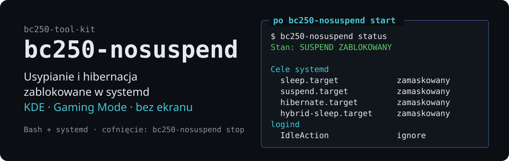

# bc250-nosuspend

<!-- opis: trwała blokada usypiania systemu (suspend i hibernacja) -->

[English](README.md) · **Polski**

<p align="center">
  
</p>

Blokuje usypianie i hibernację BC-250 na poziomie **systemd**, a nie w ustawieniach
pulpitu — dzięki temu działa tak samo w KDE, w Gaming Mode i na maszynie bez ekranu.

Część zestawu [bc250-tool-kit](../../README.pl.md) — narzędzie jest samodzielne
i działa niezależnie od pozostałych.

## Po co

BC-250 bywa używana jako konsola, serwer domowy albo maszyna do inferencji.
W każdym z tych zastosowań uśpienie w środku długiego zadania — kompilacji,
pobierania gry, sesji Ollamy — jest po prostu stratą. Ustawienia zasilania
w KDE bywają nadpisywane przez aktualizacje obrazu Bazzite i nie obowiązują
w Gaming Mode, więc pewniejsze jest odcięcie usypiania w samym systemd.

## Użycie

```bash
bc250-nosuspend status     # co jest zablokowane i przez co
bc250-nosuspend start      # zablokuj usypianie (trwale, także po restarcie)
bc250-nosuspend stop       # zdejmij blokadę założoną tym narzędziem
bc250-nosuspend default    # przywróć domyślne zachowanie systemu
```

`start` odpowiada też na `on` i `disable`, `stop` na `off` i `enable`,
`default` na `reset`. `status` działa bez uprawnień roota. `start`, `stop` i `default` ich wymagają —
narzędzie samo ponawia wywołanie przez `sudo`.

Przed każdą zmianą warto zobaczyć, co się wydarzy:

```bash
bc250-nosuspend start --dry-run
```

### Przykładowy `status`

```
bc250-nosuspend 0.1.0

  Stan: SUSPEND ZABLOKOWANY

  Cele systemd
    sleep.target                     zamaskowany
    suspend.target                   zamaskowany
    hibernate.target                 zamaskowany
    hybrid-sleep.target              zamaskowany
    suspend-then-hibernate.target    zamaskowany

  logind
    IdleAction                       ignore — bezczynność nie usypia
    drop-in bc250-nosuspend          obecny  /etc/systemd/logind.conf.d/10-bc250-nosuspend.conf

  Inne
    aktywne inhibitory               6  (systemd-inhibit --list)
```

### Kody wyjścia `status`

| Kod | Znaczenie |
|---|---|
| 0 | usypianie zablokowane |
| 1 | usypianie możliwe |
| 2 | blokada częściowa |

Nadaje się do skryptów:

```bash
bc250-nosuspend status >/dev/null || bc250-nosuspend start
```

## Co dokładnie robi

`start` wykonuje dwie rzeczy:

1. **Maskuje pięć celów systemd** — `sleep.target`, `suspend.target`,
   `hibernate.target`, `hybrid-sleep.target`, `suspend-then-hibernate.target`.
   Zamaskowany cel to dowiązanie do `/dev/null`, więc każde żądanie uśpienia —
   z pulpitu, z klawiatury czy przez `systemctl suspend` — kończy się błędem.
2. **Dokłada drop-in do logind** z `IdleAction=ignore`, żeby sama bezczynność
   nie próbowała niczego usypiać.

Obie zmiany są trwałe i przeżywają restart. Szczegóły: [`docs/how-it-works.pl.md`](docs/how-it-works.pl.md).

## Różnica między `stop` a `default`

To nie są synonimy:

- **`stop`** cofa **dokładnie to, co zrobił `start`**. Jeżeli któryś cel był
  zamaskowany jeszcze przed założeniem blokady — bo zrobiłeś to wcześniej ręcznie
  albo zrobił to inny pakiet — `stop` zostawia go zamaskowanym i mówi o tym wprost.
  Stan sprzed zmiany zapisywany jest w `/var/lib/bc250-nosuspend/previous-mask-state`.
- **`default`** odmaskowuje **wszystkie** cele niezależnie od tego, kto je
  zamaskował, i usuwa drop-in. To wyjście awaryjne, gdy chcesz wrócić do stanu
  fabrycznego dystrybucji.

## Czego nie robi

Nie dotyka **wygaszania ekranu** ani wygaszacza — to osobny mechanizm
(KDE Powerdevil, Steam Gaming Mode), niezwiązany z usypianiem systemu.
Ekran może więc dalej gasnąć przy zablokowanym suspendzie; to zamierzone.

Nie zarządza też chwilową blokadą na czas jednego polecenia — do tego służy
systemowe `systemd-inhibit`:

```bash
systemd-inhibit --what=sleep --why="kompilacja" make -j16
```

## Język

Komunikaty i dokumentacja są po angielsku i po polsku. Język wybierany jest
w kolejności: opcja `--lang pl|en`, zmienna `BC250_LANG`, locale systemu,
a w ostateczności angielski.

```bash
bc250-nosuspend --lang pl status
BC250_LANG=pl bc250-nosuspend status
LANG=pl_PL.UTF-8 man bc250-nosuspend      # polska strona podręcznika
```

## Instalacja

### Bez instalacji

```bash
./run.sh bc250-nosuspend status              # z katalogu głównego zestawu
./tools/bc250-nosuspend/bin/bc250-nosuspend  # albo bezpośrednio
```

### Na stałe

Dowiązanie w `~/.local/bin` plus strona podręcznika w `~/.local/share/man`,
bez uprawnień roota, przeżywa aktualizacje obrazu na dystrybucjach atomowych:

```bash
./tools/bc250-nosuspend/install.sh   # z katalogu głównego zestawu
man bc250-nosuspend
```

## Dokumentacja

- **[`man/pl/bc250-nosuspend.1`](man/pl/bc250-nosuspend.1)** — strona podręcznika (`LANG=pl_PL.UTF-8 man bc250-nosuspend`)
- **[`docs/how-it-works.pl.md`](docs/how-it-works.pl.md)** — mechanizm blokady, pliki,
  odwracanie zmian ręcznie, zachowanie na dystrybucjach atomowych

## Testy

Testy podstawiają atrapę `systemctl`, więc **nie dotykają prawdziwego systemu**:

```bash
./tests/test-bc250-nosuspend.sh
```

## Wymagania

Bash 4+, systemd. Bez zależności zewnętrznych.

## Licencja

MIT — patrz [LICENSE](../../LICENSE) w katalogu głównym repozytorium.
