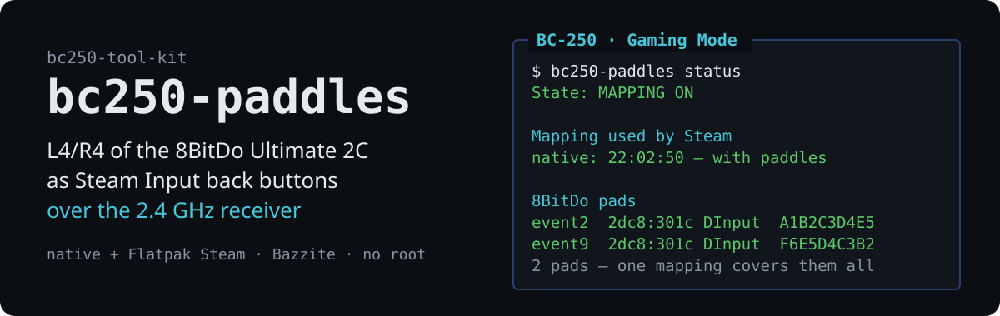
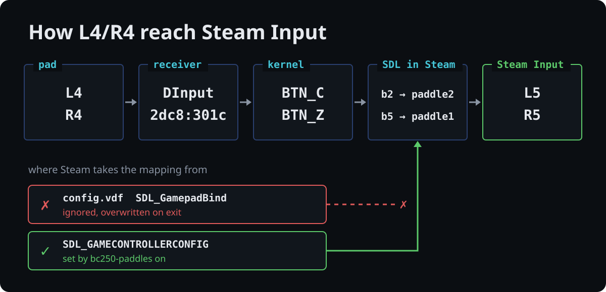
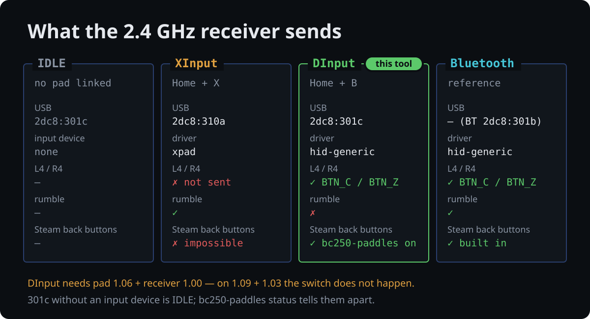

# bc250-paddles

<!-- description: L4/R4 of the 8BitDo Ultimate 2C as Steam back buttons (2.4 GHz) -->

**English** · [Polski](README.pl.md)


<p align="center">
  
</p>

Turns on and off an SDL mapping that lets Steam Input see **L4 and R4** of the
**8BitDo Ultimate 2C Wireless** on its **2.4 GHz receiver** as two independent
back buttons (L5/R5 in the controller test).

Part of the [bc250-tool-kit](../../README.md). The tool is self-contained and
works independently of the rest.

## Why

Over Bluetooth, Steam handles L4/R4 on its own. Over the 2.4 GHz receiver
they are not available, even though DInput mode sends them. The reasons:

- **XInput mode (`2dc8:310a`)** emulates an Xbox 360 pad, whose packet has no
  room for extra buttons. L4/R4 are not sent at all, as `usbmon` confirms.
- **DInput mode (`2dc8:301c`)** sends L4 and R4 as their own buttons. Steam
  still builds an automatic SDL mapping **without** them. It ignores
  `SDL_GamepadBind` in `config.vdf` and overwrites it on exit.
- **The `SDL_GAMECONTROLLERCONFIG` variable:** Steam does apply a mapping
  passed in it. This tool sets and removes that variable.

<p align="center">
  
</p>

Details and measurements: [`docs/how-it-works.md`](docs/how-it-works.md).

## Requirements

<p align="center">
  
</p>

The mapping works **only when all of these hold**:

| # | Requirement | How to check |
|---|---|---|
| 1 | An **Ultimate 2C Wireless** on the **2.4 GHz receiver** (not on a cable, not over BT) | `lsusb \| grep 2dc8` |
| 2 | Firmware that allows DInput. Verified: **pad 1.06 + receiver 1.00**. On **pad 1.09 + receiver 1.03**, switching to DInput does not work. | Ultimate Software V2 |
| 3 | The pad in **DInput** mode: the receiver shows up as `2dc8:301c` **with an input device**. Switch with Home + B; back to XInput with Home + X. | `bc250-paddles status`, the "8BitDo pads" section |
| 4 | L4/R4 **not remapped** inside the pad (an on-pad remap copies another button, and the pad then does not send them separately) | the L4+A test: both buttons must show up independently |
| 5 | Steam **started after** `bc250-paddles on`. Native Steam in Gaming Mode: after logging out or rebooting. | `bc250-paddles status`, the "Running Steam" and "Mapping used by Steam" sections |
| 6 | Nothing else sets `SDL_GAMECONTROLLERCONFIG` for Steam | `status` warns about a foreign value; `on` will not overwrite it |

What to expect in DInput mode:

- **No rumble.** The kernel exposes no force feedback for this device, and the
  firmware ignores the output report from the descriptor.
- **Button layout.** LT/RT are analog, and the right stick is `ABS_Z`/`ABS_RZ`.

So the choice is between DInput on the receiver (L4/R4, no rumble), XInput on
the receiver (rumble, no L4/R4) and Bluetooth (both).

`2dc8:301c` **without** an input device is the receiver with no pad linked
(IDLE), not DInput mode.

## Usage

```bash
bc250-paddles status     # mapping state, running Steam, Steam's log, pads
bc250-paddles on         # set the mapping (persistently)
bc250-paddles off        # remove the mapping this tool set
bc250-paddles mapping    # print the bare SDL mapping
```

By default the tool acts on the **detected** Steam installations: native
(`~/.local/share/Steam`) and Flatpak (`com.valvesoftware.Steam`). Choose one
with `--target native|flatpak|all`. `on` also answers to `start` and `enable`,
`off` to `stop` and `disable`. No command needs root.

Before a change it is worth seeing what will happen:

```bash
bc250-paddles on --dry-run
```

### A sample `status`

```
bc250-paddles 0.1.0

  State: MAPPING ON

  Steam installations
    native    set (environment.d)
              ~/.local/share/Steam

  Running Steam
    pid 4242 (native): mapping in the process environment

  Mapping used by Steam (logs/controller.txt)
    native: 2026-10-24 21:34:02 — with paddles (L4/R4 available)

  8BitDo pads
    event18  2dc8:301c DInput over the receiver — L4/R4 are sent
```

The line that matters most is the one from Steam's log. It shows the mapping
Steam **actually used** the last time the pad connected. If it says "WITHOUT
paddles", Steam did not get the variable and has to be restarted.

### Exit codes of `status`

| Code | Meaning |
|---|---|
| 0 | the mapping is set in every detected installation |
| 1 | the mapping is not set, or no Steam was found |
| 2 | the mapping is set in some installations only |

## What exactly it does

`on` places the mapping in up to two places, depending on the installation:

| Steam | Change | Where Steam picks it up |
|---|---|---|
| native (Bazzite, Gaming Mode and desktop) | the file `~/.config/environment.d/90-bc250-paddles.conf` plus `systemctl --user set-environment` | the user session environment after login |
| Flatpak | `flatpak override --user --env=SDL_GAMECONTROLLERCONFIG=…` | the Flatpak sandbox environment |

`off` undoes **only its own** changes. It removes the `environment.d` file and
the variable from the user manager, and removes only that one variable from the
Flatpak override. Other overrides (e.g. `filesystems`, `MANGOHUD`) stay. The tool
never overwrites or removes somebody else's `SDL_GAMECONTROLLERCONFIG`.

The changes persist across reboots and Bazzite image updates, because they live
in the home directory. No `rpm-ostree` needed.

## Testing two pads

Both pad + receiver sets have the same VID/PID, version and name, so **one
mapping covers both**. After `on` and a Steam restart:

1. `bc250-paddles status`: two `2dc8:301c DInput` entries.
2. Steam → Settings → Controller → each pad in turn → Test: L4 lights L5, and
   R4 lights R5.
3. Bind L4/R4 on pad 1 to different actions than on pad 2. Hold L4 on one pad
   and R4 on the other: both inputs must show up independently.

## Language

Messages and documentation are in English and Polish. The language is chosen in
this order: the `--lang pl|en` option, the `BC250_LANG` variable, the system
locale, and finally English.

## Installation

### Without installing

```bash
./run.sh bc250-paddles status              # from the kit's root directory
./tools/bc250-paddles/bin/bc250-paddles    # or directly
```

### Permanently

A symlink in `~/.local/bin` plus the manual page in `~/.local/share/man`. No
root needed, and it survives image updates on atomic distributions:

```bash
./tools/bc250-paddles/install.sh   # from the kit's root directory
man bc250-paddles
```

## Documentation

- **[`man/en/bc250-paddles.1`](man/en/bc250-paddles.1)**: the manual page (`man bc250-paddles`)
- **[`docs/how-it-works.md`](docs/how-it-works.md)**: receiver modes, measurements, why `config.vdf` is not enough, rumble, undoing the changes by hand

## Tests

The tests run in a sandbox with stubbed `flatpak` and `systemctl`, so they
**never touch the real system or Steam**:

```bash
./tests/test-bc250-paddles.sh
```

## Dependencies

Bash 4+, systemd (user session). `flatpak` only for Flatpak Steam. No other
dependencies.

## License

MIT, see [LICENSE](../../LICENSE) in the repository root.
