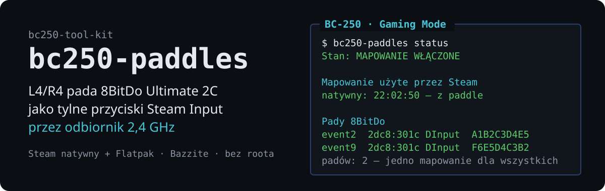
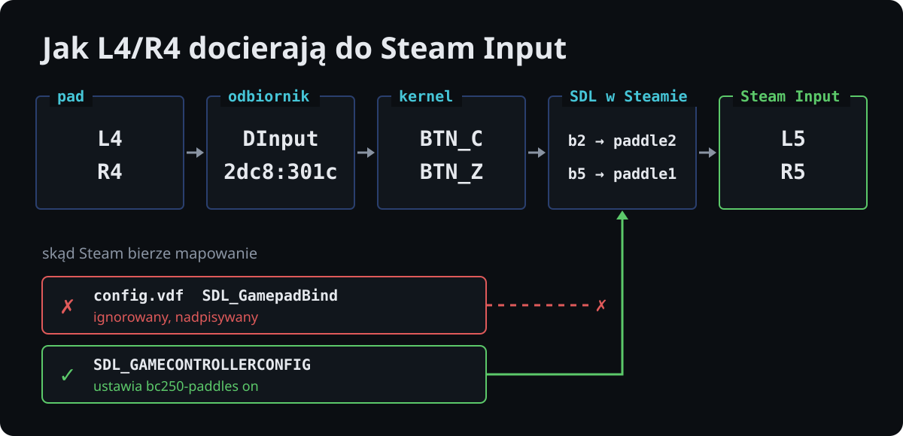
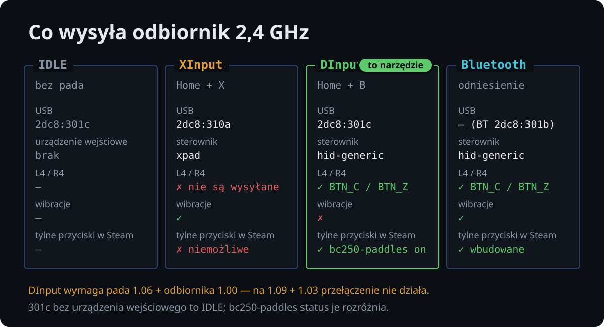

# bc250-paddles

<!-- opis: L4/R4 pada 8BitDo Ultimate 2C jako tylne przyciski Steam (2,4 GHz) -->

[English](README.md) · **Polski**


<p align="center">
  
</p>

Włącza i wyłącza mapowanie SDL, dzięki któremu Steam Input widzi **L4 i R4**
pada **8BitDo Ultimate 2C Wireless** podłączonego przez **odbiornik 2,4 GHz**
jako dwa niezależne tylne przyciski (w teście kontrolera: L5/R5).

Część zestawu [bc250-tool-kit](../../README.pl.md). Narzędzie jest samodzielne
i działa niezależnie od pozostałych.

## Po co

Przez Bluetooth Steam obsługuje L4/R4 samodzielnie. Przez odbiornik 2,4 GHz
L4/R4 nie są dostępne, choć tryb DInput je wysyła. Powody:

- **Tryb XInput (`2dc8:310a`)** emuluje pada Xbox 360, którego pakiet nie ma
  miejsca na dodatkowe przyciski. L4/R4 w ogóle nie są wysyłane, co potwierdza
  podsłuch `usbmon`.
- **Tryb DInput (`2dc8:301c`)** wysyła L4 i R4 jako osobne przyciski. Steam
  i tak buduje automatyczne mapowanie SDL **bez nich**. Wpis `SDL_GamepadBind`
  w `config.vdf` ignoruje i nadpisuje przy wyjściu.
- **Zmienna `SDL_GAMECONTROLLERCONFIG`:** mapowanie przekazane w tej zmiennej
  Steam stosuje. To narzędzie ustawia ją i usuwa.

<p align="center">
  
</p>

Szczegóły i pomiary: [`docs/how-it-works.pl.md`](docs/how-it-works.pl.md).

## Warunki

<p align="center">
  
</p>

Mapowanie działa **tylko wtedy, gdy wszystkie poniższe warunki są spełnione**:

| # | Warunek | Jak sprawdzić |
|---|---|---|
| 1 | Pad **Ultimate 2C Wireless** na **odbiorniku 2,4 GHz** (nie na kablu, nie przez BT) | `lsusb \| grep 2dc8` |
| 2 | Firmware pozwalający na tryb DInput. Sprawdzone: **pad 1.06 + odbiornik 1.00**. Na **pad 1.09 + odbiornik 1.03** przełączenie w DInput nie działa. | Ultimate Software V2 |
| 3 | Pad w trybie **DInput**: odbiornik zgłasza się jako `2dc8:301c` **z urządzeniem wejściowym**. Przełączenie: Home + B, powrót do XInput: Home + X. | `bc250-paddles status`, sekcja „Pady 8BitDo” |
| 4 | L4/R4 **nie są przypisane** w samym padzie (wbudowany remap kopiuje inny przycisk i pad nie wysyła ich osobno) | test L4+A: oba przyciski mają się pojawić niezależnie |
| 5 | Steam **uruchomiony po** `bc250-paddles on`. Steam natywny w Gaming Mode: po wylogowaniu albo restarcie. | `bc250-paddles status`, sekcje „Uruchomiony Steam” i „Mapowanie użyte przez Steam” |
| 6 | Nikt inny nie ustawia `SDL_GAMECONTROLLERCONFIG` dla Steama | `status` ostrzega o obcej wartości; `on` jej nie nadpisze |

Czego się spodziewać w trybie DInput:

- **Brak wibracji.** Kernel nie udostępnia dla tego urządzenia force feedback,
  a firmware nie reaguje na raport wyjściowy z deskryptora.
- **Układ przycisków.** LT/RT są analogowe, prawa gałka to `ABS_Z`/`ABS_RZ`.

Wybierasz więc między: DInput przez odbiornik (L4/R4 bez wibracji), XInput
przez odbiornik (wibracje bez L4/R4) a Bluetooth (oba).

`2dc8:301c` **bez** urządzenia wejściowego to odbiornik bez połączonego pada
(stan IDLE), a nie tryb DInput.

## Użycie

```bash
bc250-paddles status     # stan mapowania, uruchomiony Steam, log Steama, pady
bc250-paddles on         # ustaw mapowanie (trwale)
bc250-paddles off        # usuń mapowanie ustawione tym narzędziem
bc250-paddles mapping    # wypisz samo mapowanie SDL
```

Domyślnie narzędzie działa na **wykrytych** instalacjach Steama: natywnej
(`~/.local/share/Steam`) i z Flatpaka (`com.valvesoftware.Steam`). Konkretną
wskazuje się opcją `--target native|flatpak|all`. `on` odpowiada też na `start` i `enable`,
`off` na `stop` i `disable`. Żadna komenda nie wymaga roota.

Przed zmianą warto zobaczyć, co się wydarzy:

```bash
bc250-paddles on --dry-run
```

### Przykładowy `status`

```
bc250-paddles 0.1.0

  Stan: MAPOWANIE WŁĄCZONE

  Instalacje Steama
    natywny   ustawione (environment.d)
              ~/.local/share/Steam

  Uruchomiony Steam
    pid 4242 (natywny): mapowanie w środowisku procesu

  Mapowanie użyte przez Steam (logs/controller.txt)
    natywny: 2026-10-24 21:34:02 — z paddle (L4/R4 dostępne)

  Pady 8BitDo
    event18  2dc8:301c DInput przez odbiornik — L4/R4 wysyłane
```

Najważniejsza jest linia z logu Steama. Pokazuje, jakiego mapowania Steam
**faktycznie użył** przy ostatnim połączeniu pada. Jeśli jest tam „BEZ paddle”,
Steam nie dostał zmiennej i trzeba go uruchomić ponownie.

### Kody wyjścia `status`

| Kod | Znaczenie |
|---|---|
| 0 | mapowanie ustawione we wszystkich wykrytych instalacjach |
| 1 | mapowanie nieustawione albo brak Steama |
| 2 | mapowanie ustawione tylko w części instalacji |

## Co dokładnie robi

`on` zostawia kopię mapowania w dwóch miejscach, zależnie od instalacji:

| Steam | Zmiana | Skąd Steam ją weźmie |
|---|---|---|
| natywny (Bazzite, Gaming Mode i pulpit) | plik `~/.config/environment.d/90-bc250-paddles.conf` oraz `systemctl --user set-environment` | środowisko sesji użytkownika po zalogowaniu |
| Flatpak | `flatpak override --user --env=SDL_GAMECONTROLLERCONFIG=…` | środowisko piaskownicy Flatpaka |

`off` cofa **tylko własne** zmiany. Usuwa plik `environment.d` i zmienną
z menedżera użytkownika, a z override'u Flatpaka usuwa wyłącznie tę jedną
zmienną. Inne override'y (np. `filesystems`, `MANGOHUD`) zostają.
Cudzej wartości `SDL_GAMECONTROLLERCONFIG` narzędzie nie nadpisuje ani nie usuwa.

Zmiany są trwałe i przeżywają restart oraz aktualizacje obrazu Bazzite, bo
leżą w katalogu domowym. Nie jest potrzebny `rpm-ostree`.

## Test dwóch padów

Oba zestawy pad + odbiornik mają ten sam VID/PID, wersję i nazwę, więc
**jedno mapowanie obejmuje oba**. Po `on` i ponownym uruchomieniu Steama:

1. `bc250-paddles status`: dwa wpisy `2dc8:301c DInput`.
2. Steam → Ustawienia → Kontroler → każdy pad osobno → Test: L4 zapala L5,
   a R4 zapala R5.
3. Przypisz L4/R4 na padzie 1 do innych akcji niż na padzie 2. Przytrzymaj
   L4 na jednym padzie i R4 na drugim: oba wejścia muszą być widoczne niezależnie.

## Język

Komunikaty i dokumentacja są po angielsku i po polsku. Kolejność wyboru języka:
opcja `--lang pl|en`, zmienna `BC250_LANG`, locale systemu, a w ostateczności
angielski.

## Instalacja

### Bez instalacji

```bash
./run.sh bc250-paddles status              # z katalogu głównego zestawu
./tools/bc250-paddles/bin/bc250-paddles    # albo bezpośrednio
```

### Na stałe

Dowiązanie w `~/.local/bin` i strona podręcznika w `~/.local/share/man`.
Nie wymaga roota i przeżywa aktualizacje obrazu na dystrybucjach atomowych:

```bash
./tools/bc250-paddles/install.sh   # z katalogu głównego zestawu
man bc250-paddles
```

## Dokumentacja

- **[`man/pl/bc250-paddles.1`](man/pl/bc250-paddles.1)**: strona podręcznika (`LANG=pl_PL.UTF-8 man bc250-paddles`)
- **[`docs/how-it-works.pl.md`](docs/how-it-works.pl.md)**: tryby odbiornika, pomiary, dlaczego `config.vdf` nie wystarcza, wibracje, ręczne cofnięcie zmian

## Testy

Testy działają w piaskownicy z atrapami `flatpak` i `systemctl`, więc
**nie dotykają prawdziwego systemu ani Steama**:

```bash
./tests/test-bc250-paddles.sh
```

## Zależności

Bash 4+, systemd (sesja użytkownika). `flatpak` tylko dla Steama z Flatpaka.
Brak innych zależności.

## Licencja

MIT, patrz [LICENSE](../../LICENSE) w katalogu głównym repozytorium.
