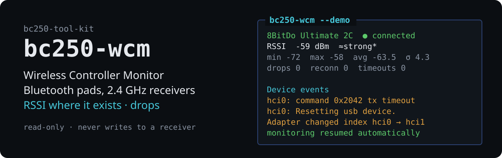

# bc250-wcm — Wireless Controller Monitor

<!-- description: Wireless Controller Monitor — Bluetooth pads and USB 2.4 GHz receivers -->

**English** · [Polski](README.pl.md)


<p align="center">
  
</p>

A terminal monitor for wireless game controllers, in the style of `btop`:
Bluetooth pads (LE and Classic) and pads on dedicated **USB 2.4 GHz receivers**,
side by side, one to four at a time. It shows what each link can really tell —
the RSSI of a live Bluetooth link, the state of a receiver, the controller's
input activity — keeps history, counts drops and reconnects, and survives an
adapter that resets and comes back as another `hciN` or a receiver that
re-enumerates with another product ID.

Formerly **bc250-btmon** (Bluetooth only). The old command name still works;
settings, history and exports are copied over on the first start. The command
is deliberately not `btmon` — that is BlueZ's own HCI tracer.

Part of the [bc250-tool-kit](../../README.md); self-contained.

```
 WCM  Devices: 3   BT: hci1 ●   USB: 1                         Status: OK │ RSSI: mgmt helper │ 1 s │ 21:03:30
╭─ 1 8BitDo Ultimate 2C Wireless ·00:01 ─ ● connected 8s ─╮╭─ 2 8BitDo Ultimate 2C Wireless ·00:02 ─ ● connected 7s ─╮
│ E4:17:D8:00:00:01 · LE random · hci1 · gamepad          ││ E4:17:D8:00:00:02 · LE random · hci1 · gamepad          │
│ RSSI  -63 dBm  ███████████████▉░░░░░░░░░░░░░░ ≈fair*    ││ RSSI  -67 dBm  ██████████████▏░░░░░░░░░░░░░░░ ≈fair*    │
│  -55┤                                            ⡀      ││  -65┤                                                 ⡸ │
│  -62┤                                          ⣄⡦⠻⡀   ⢠ ││  -72┤                                          ⠒⣤⡀  ⣄⢠⠃ │
│  -70┤                                             ⠸⠃⠁   ││  -80┤                                         ▁         │
│ min -67  max -61  avg -64.1  σ 1.5                  50s ││ min -76  max -67  avg -73.5  σ 2.3                  50s │
╰─────────────────────────────────────────────────────────╯╰─────────────────────────────────────────────────────────╯
╭─ 3 8BitDo Ultimate 2C · 2.4 GHz receiver ───────────────╮╭─ Device events ─────────────────────────── l: full log ─╮
│ 2dc8:310a · USB 1-3 · usbhid, xpad · USB 2.4 GHz        ││ 21:03:17 Adapter hci1 00:E0:4C:DE:00:01 (USB 2c4e:0115) │
│ Link  pad linked to the receiver (from the USB product… ││ 21:03:25 receiver (USB 1-3): 2dc8:310a → 2dc8:301c      │
│ RSSI: n/a — not reported by the receiver   Battery: n/a ││ 21:03:27 receiver (USB 1-3): 2dc8:301c → 2dc8:310a      │
│ input activity, events/s — pad use, not signal strength ││ 21:03:30 Bluetooth: hci1: command 0x2042 tx timeout  [… │
│   72┤                                          ⡇      ⢰ ││                                                         │
│    0┤                                          ⣿⣾⣤⡄▁⢸⡄⣼ ││                                                         │
│ Input 48/s  total 102  last input 0s                    ││                                                         │
╰─────────────────────────────────────────────────────────╯╰─────────────────────────────────────────────────────────╯
```

*(The `--demo` simulation, trimmed.)*

## What each technology can tell

| | Bluetooth (BlueZ) | USB 2.4 GHz receiver (8BitDo Ultimate 2C) |
|---|---|---|
| present / connected | `Device1.Connected`, per-bearer state | USB product ID and input device: `2dc8:310a` pad in XInput mode, `2dc8:301c` with a gamepad pad in DInput mode, `2dc8:301c` without one no pad (IDLE) |
| signal strength | **RSSI of the live link** (kernel mgmt, needs the helper) | **not available** — shown as `n/a`, never estimated |
| battery | `Battery1`, kernel HID `power_supply` if present | not sent by stock firmware over 2.4 GHz → `n/a` |
| activity | input events/s from the pad's evdev node | input events/s from the pad's evdev node |
| drops | disconnects with the kernel's reason | pad off / out of range (IDLE) vs receiver unplugged |
| adapter trouble | HCI timeouts, USB resets, `hciN` remaps | re-enumeration with new hidraw/event numbers |

Input activity says the pad is **being used**, not how good the radio is; a pad
lying on the table is connected and silent, and the monitor never calls that a
disconnect. Details and sources: [docs/usb-receivers.md](docs/usb-receivers.md).

## Views

- **Device list** — Bluetooth devices and USB controllers together: name, MAC or
  USB ID and port, type and transport, Connected / Paired / Bonded / Trusted
  (the last three are Bluetooth notions, `—` for USB), RSSI, battery. Filter
  (all / connected / paired / discovered / Bluetooth / USB), search, sort; pick
  **1–4** with Space or the row number, Enter to monitor. The last selection is
  remembered.
- **Dashboard** — a panel per controller in a grid (2 × 2 for four); with one or
  three controllers the free cell shows the **device events** feed. Bluetooth
  panels: RSSI graph with min/max/avg/σ. Receiver panels: link state from the
  USB product ID, `RSSI n/a`, and an input-activity graph clearly labelled as
  such. Compact panels on small terminals.
- **Details** (Enter) — everything known about the device. For a receiver:
  place on the bus, IDs, bcdDevice, profile, product-ID history, interfaces
  with drivers, hidraw and event nodes.
- **Event log** (`l`), **export** (`e` CSV, `j` JSON), **help** (`h`).

## HID research tool

For finding out what a vendor-defined interface sends — strictly passive:

```bash
bc250-wcm hid list                          # every hidraw node, its reports, vendor pages, access
bc250-wcm hid descriptor 2dc8:310a:2        # raw + decoded descriptor (selector survives re-plugging)
bc250-wcm hid capture 2dc8:310a:2 -t 30 -o idle.jsonl --marks   # hex, changed bytes in [ ]
bc250-wcm hid analyze idle.jsonl pressed.jsonl                   # which bytes change, with which marks
```

It cannot write: nodes are opened read-only and there is no code that sends a
report. That is deliberate — on the 8BitDo receiver the vendor interface is also
the firmware-update channel. See [docs/usb-receivers.md](docs/usb-receivers.md#researching-an-unknown-hid-interface-safely).

## Installation

Standard library only — no `pip`, no `rpm-ostree install`. Python 3.9+, BlueZ,
`journalctl`.

```bash
./run.sh bc250-wcm --demo                       # simulation: BT pads, a receiver, resets
./tools/bc250-wcm/install.sh                    # ~/.local/bin (+ bc250-btmon alias), man pages
./tools/bc250-wcm/install.sh --rssi-helper      # optional: Bluetooth link RSSI without a prompt
./tools/bc250-wcm/install.sh --udev             # optional: hidraw access for `hid capture`
```

Permissions in short: Bluetooth state, USB detection and input activity need
nothing (gamepad event nodes carry `uaccess`). Bluetooth **link RSSI** needs a
small read-only helper through sudo. `hid capture` needs read access to the
receiver's hidraw node — Steam's `60-steam-input.rules` usually gives it already.
[docs/permissions.md](docs/permissions.md).

## Usage

```bash
bc250-wcm                                       # device list, then the dashboard
bc250-wcm -m E4:17:D8:00:00:01 usb:1-3          # a BT pad and the receiver, straight away
bc250-wcm --list | --json                       # what is there (BT + USB)
bc250-wcm --headless 120 -m usb:1-3 --export run.json
bc250-wcm --no-usb | --no-input-activity | --no-sudo
bc250-wcm --print-config > ~/.config/bc250-wcm/config.ini
```

Keys: Space/`1`–`9` select · Enter monitor/details · Tab/arrows/`1`–`4` panel ·
`s` selection · `p` pause · `l` log · `e`/`j` export · `r` reset · `+`/`-`
interval · `c` compact · `g` graph style · `/` `f` `o` search/filter/sort ·
`d` discovery (off by default; LE scanning is what timed out as 0x2042 on the
RTL8761BU) · `h` help · `q` quit.

## Documentation

- [docs/architecture.md](docs/architecture.md) — backends, data flow, identity, sampling
- [docs/usb-receivers.md](docs/usb-receivers.md) — supported receivers, metrics, limits, adding a receiver, HID research
- [docs/permissions.md](docs/permissions.md) — helper, sudo, udev
- [docs/hardware-testing.md](docs/hardware-testing.md) — step by step on real pads and the receiver
- [man/en/bc250-wcm.1](man/en/bc250-wcm.1)

## Tests

```bash
cd tools/bc250-wcm && python3 -m unittest discover -s tests -v
python3 dev/tuishot.py 160 45 --keys '2 3 4 \r ~5'      # TUI screenshot from the demo
```

No hardware needed: BlueZ, mgmt, `btmgmt`, the helper, sysfs (a fake tree with
the receiver in both modes), hidraw and evdev are simulated. A few tests touch
the real system read-only when it is there and skip otherwise.

## Language

The interface and documentation come in Polish and English: the `--lang pl|en`
option, then the `BC250_LANG` variable, then the system locale, falling back to
English. `man bc250-wcm` is English, `LANG=pl_PL.UTF-8 man bc250-wcm` Polish.

## Licence

MIT — see [LICENSE](../../LICENSE) in the repository root.
