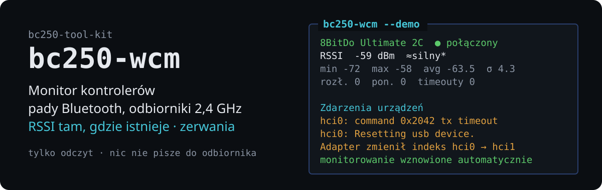

# bc250-wcm — Wireless Controller Monitor

<!-- description: Wireless Controller Monitor — Bluetooth pads and USB 2.4 GHz receivers -->

[English](README.md) · **Polski**


<p align="center">
  
</p>

Terminalowy monitor bezprzewodowych kontrolerów do gier w stylu `btop`: pady
Bluetooth (LE i Classic) oraz pady na dedykowanych **odbiornikach USB 2,4 GHz**,
obok siebie, od jednego do czterech naraz. Pokazuje to, co dane łącze naprawdę
mówi — RSSI aktywnego połączenia Bluetooth, stan odbiornika, aktywność wejścia
pada — prowadzi historię, liczy rozłączenia i powroty, i przetrwa adapter, który
się resetuje i wraca jako inny `hciN`, albo odbiornik, który zgłasza się
ponownie z innym ID produktu.

Wcześniej **bc250-btmon** (tylko Bluetooth). Stara nazwa polecenia nadal działa;
ustawienia, historia i eksporty są kopiowane przy pierwszym starcie. Polecenie
celowo nie nazywa się `btmon` — tak nazywa się narzędzie BlueZ do śledzenia HCI.

Część [bc250-tool-kit](../../README.pl.md); samodzielne.

```
 WCM  Urządzenia: 2   BT: hci1 ●   USB: 1                       Status: ERROR │ RSSI: mgmt (demo) │ 0.25 s │ 22:28:52
╭─ 1 8BitDo Ultimate 2C Wireless ·00:01 ─ ● połączony 8s ─╮╭─ 2 8BitDo Ultimate 2C Wireless ·00:02 ─ ● połączony 8s ─╮
│ E4:17:D8:00:00:01 · LE random · hci1 · gamepad          ││ E4:17:D8:00:00:02 · LE random · hci1 · gamepad          │
│ RSSI  -68 dBm  █████████████▊░░░░░░░░░░░░░░░░ ≈średni*  ││ RSSI  -75 dBm  ██████████▊░░░░░░░░░░░░░░░░░░░ ≈słaby*   │
│ Moc TX: 0 dBm (zgłoszona)    Bateria: n/d               ││ Moc TX: 0 dBm (zgłoszona)    Bateria: n/d               │
│  -55┤                                                   ││  -60┤                                                   │
│     ┤                                            ⡖⣄     ││     ┤                                            ⢀⡀     │
│     ┤                                           ⢰⠁ ⣇    ││     ┤                                  ⣀        ⢀⡸⠘⡄    │
│     ┤                                 ⠒⢢⣀       ⡎   ⢣   ││     ┤                                 ⡰⠁⡇       ⡸  ⢣    │
│  -65┤                                  ⠸⠃⠧⡀     ⡇   ⢸   ││  -70┤                                   ⠸⢄      ⡇  ⠸⡀   │
│     ┤                                     ⠧⡀ ⣄⢠⠜    ⠈⠦⢄ ││     ┤                                    ⠸⡀    ⡜    ⠟⢆  │
│     ┤                                      ⢇⢸⠸⠃       ⠈ ││     ┤                                     ⢇   ⢠⠃     ⠈⢆ │
│     ┤                                      ⠈⠁           ││     ┤                                     ⠸⡀⢸⣦⠃       ⠈ │
│     ┤                                                   ││     ┤                                      ⢣⠎⠋          │
│  -75┤                                                   ││  -80┤                                                   │
│ min -70  max -59  avg -65.0  σ 3.1                  25s ││ min -78  max -65  avg -71.4  σ 3.8                  25s │
│ RSSI 100%  rozł. 0  pon. 0  przerwy 0                   ││ RSSI 100%  rozł. 0  pon. 0  przerwy 0                   │
╰─────────────────────────────────────────────────────────╯╰─────────────────────────────────────────────────────────╯
╭─ Diagnostyka ────────────────────────────────────────────────────────────────────────────────────── 4 · więcej: l ─╮
│ ✖ hci0: w dzienniku jądra 1× timeout komendy HCI, 1× reset USB, 0× błąd sprzętowy.                                 │
│ ▲ Adapter 00:E0:4C:DE:00:01 zmienił indeks hci0 → hci1 o 22:28:43 (razy: 1); monitorowanie wznowione automatyczni… │
╰────────────────────────────────────────────────────────────────────────────────────────────────────────────────────╯
```

*(Symulacja `--demo`, przycięta: dwa pady i reset adaptera hci0 → hci1.)*

## Co mówi każda technologia

| | Bluetooth (BlueZ) | Odbiornik USB 2,4 GHz (8BitDo Ultimate 2C) |
|---|---|---|
| obecność / połączenie | `Device1.Connected`, stan na nośnik | ID produktu USB i urządzenie wejściowe: `2dc8:310a` pad w trybie XInput, `2dc8:301c` z padem wejściowym — pad w trybie DInput, `2dc8:301c` bez niego — brak pada (IDLE) |
| siła sygnału | **RSSI aktywnego łącza** (mgmt jądra, wymaga helpera) | **niedostępna** — pokazywana jako `n/d`, nigdy szacowana |
| bateria | `Battery1`, `power_supply` HID jądra, jeśli jest | stock firmware nie przesyła jej przez 2,4 GHz → `n/d` |
| aktywność | zdarzenia wejścia/s z węzła evdev pada | zdarzenia wejścia/s z węzła evdev pada |
| rozłączenia | z przyczyną od jądra | pad wyłączony / poza zasięgiem (IDLE) kontra odbiornik wyjęty |
| kłopoty adaptera | timeouty HCI, resety USB, zmiana `hciN` | ponowne wyliczenie z nowymi numerami hidraw/event |

Aktywność wejścia mówi, że pad jest **używany**, a nie jak dobre jest radio;
pad leżący na stole jest połączony i milczy, i monitor nigdy nie nazwie tego
rozłączeniem. Szczegóły i źródła: [docs/usb-receivers.pl.md](docs/usb-receivers.pl.md).

## Widoki

- **Lista urządzeń** — urządzenia Bluetooth i kontrolery USB razem: nazwa, MAC
  albo ID USB i port, typ i technologia, Connected / Paired / Bonded / Trusted
  (trzy ostatnie to pojęcia Bluetooth, dla USB `—`), RSSI, bateria. Filtr
  (wszystkie / połączone / sparowane / wykryte / Bluetooth / USB), wyszukiwanie,
  sortowanie; wybór **1–4** spacją albo numerem wiersza, Enter monitoruje.
  Ostatni wybór jest zapamiętywany.
- **Pulpit** — panel na kontroler w siatce (2 × 2 dla czterech); przy jednym lub
  trzech kontrolerach wolne pole pokazuje **zdarzenia urządzeń**. Panele
  Bluetooth: wykres RSSI z min/max/śr./σ. Panele odbiornika: stan łącza z ID
  produktu USB, `RSSI n/d` i wykres aktywności wejścia, wyraźnie tak opisany.
  Panele kompaktowe na małym terminalu.
- **Szczegóły** (Enter) — wszystko, co wiadomo o urządzeniu. Dla odbiornika:
  miejsce na magistrali, identyfikatory, bcdDevice, profil, historia zmian ID
  produktu, interfejsy ze sterownikami, węzły hidraw i event.
- **Dziennik zdarzeń** (`l`), **eksport** (`e` CSV, `j` JSON), **pomoc** (`h`).

## Narzędzie do badania HID

Do sprawdzania, co wysyła interfejs producenta — wyłącznie pasywnie:

```bash
bc250-wcm hid list                          # wszystkie węzły hidraw, raporty, strony producenta, dostęp
bc250-wcm hid descriptor 2dc8:310a:2        # deskryptor surowy i zdekodowany (selektor przeżywa przepięcie)
bc250-wcm hid capture 2dc8:310a:2 -t 30 -o idle.jsonl --marks   # hex, zmienione bajty w [ ]
bc250-wcm hid analyze idle.jsonl pressed.jsonl                   # które bajty się zmieniają i przy jakich znacznikach
```

Narzędzie nie potrafi pisać: węzły są otwierane tylko do odczytu i nie ma kodu
wysyłającego raport. To celowe — w odbiorniku 8BitDo interfejs producenta jest
też kanałem aktualizacji firmware'u. Patrz [docs/usb-receivers.pl.md](docs/usb-receivers.pl.md#bezpieczne-badanie-nieznanego-interfejsu-hid).

## Instalacja

Tylko biblioteka standardowa — bez `pip` i bez `rpm-ostree install`. Python 3.9+,
BlueZ, `journalctl`.

```bash
./run.sh bc250-wcm --demo                       # symulacja: pady BT, odbiornik, resety
./tools/bc250-wcm/install.sh                    # ~/.local/bin (+ alias bc250-btmon), strony man
./tools/bc250-wcm/install.sh --rssi-helper      # opcjonalnie: RSSI łącza BT bez pytania o hasło
./tools/bc250-wcm/install.sh --udev             # opcjonalnie: dostęp do hidraw dla `hid capture`
```

Uprawnienia w skrócie: stan Bluetooth, wykrywanie USB i aktywność wejścia nie
wymagają niczego (węzły event padów mają `uaccess`). **RSSI łącza** Bluetooth
wymaga małego helpera tylko-do-odczytu przez sudo. `hid capture` wymaga prawa
odczytu węzła hidraw odbiornika — zwykle daje je już `60-steam-input.rules`
Steama. [docs/permissions.pl.md](docs/permissions.pl.md).

## Użycie

```bash
bc250-wcm                                       # lista urządzeń, potem pulpit
bc250-wcm -m E4:17:D8:00:00:01 usb:1-3          # pad BT i odbiornik, od razu
bc250-wcm --list | --json                       # co jest dostępne (BT + USB)
bc250-wcm --headless 120 -m usb:1-3 --export run.json
bc250-wcm --no-usb | --no-input-activity | --no-sudo
bc250-wcm --print-config > ~/.config/bc250-wcm/config.ini
```

Klawisze: spacja/`1`–`9` wybór · Enter monitoruj/szczegóły · Tab/strzałki/`1`–`4`
panel · `s` wybór · `p` pauza · `l` dziennik · `e`/`j` eksport · `r` zeruj ·
`+`/`-` interwał · `c` kompakt · `g` styl wykresu · `/` `f` `o`
szukaj/filtr/sortuj · `d` wyszukiwanie (domyślnie wyłączone; to skanowanie LE
dostało timeout 0x2042 na RTL8761BU) · `h` pomoc · `q` wyjście.

## Dokumentacja

- [docs/architecture.pl.md](docs/architecture.pl.md) — backendy, przepływ danych, tożsamość, próbkowanie
- [docs/usb-receivers.pl.md](docs/usb-receivers.pl.md) — obsługiwane odbiorniki, metryki, ograniczenia, dodawanie odbiornika, badanie HID
- [docs/permissions.pl.md](docs/permissions.pl.md) — helper, sudo, udev
- [docs/hardware-testing.pl.md](docs/hardware-testing.pl.md) — krok po kroku na prawdziwych padach i odbiorniku
- [man/pl/bc250-wcm.1](man/pl/bc250-wcm.1)

## Testy

```bash
cd tools/bc250-wcm && python3 -m unittest discover -s tests -v
python3 dev/tuishot.py 160 45 --keys '2 3 4 \r ~5'      # zrzut TUI z demo
```

Bez sprzętu: BlueZ, mgmt, `btmgmt`, helper, sysfs (sztuczne drzewo z odbiornikiem
w obu trybach), hidraw i evdev są symulowane. Kilka testów dotyka prawdziwego
systemu tylko do odczytu, jeśli jest dostępny, a w przeciwnym razie są pomijane.

## Język

Interfejs i dokumentacja są po polsku i po angielsku: opcja `--lang pl|en`,
potem zmienna `BC250_LANG`, potem locale systemu, a w ostateczności angielski.
`man bc250-wcm` jest po angielsku, `LANG=pl_PL.UTF-8 man bc250-wcm` po polsku.

## Licencja

MIT — patrz [LICENSE](../../LICENSE) w katalogu głównym repozytorium.
